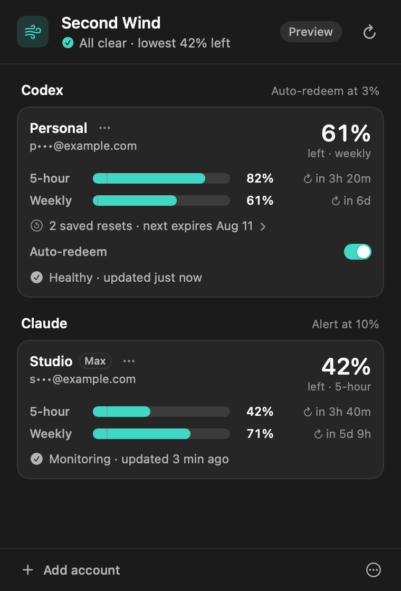
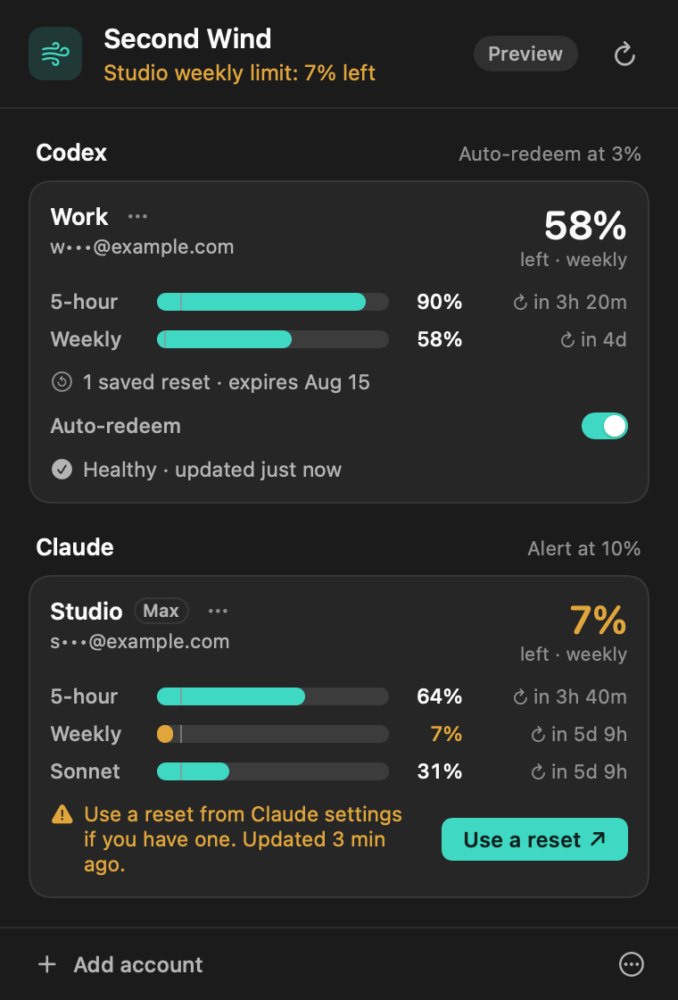

# Second Wind

A native macOS menu-bar app that watches your Codex and Claude usage limits and
helps you use a reset before you hit the wall. For Codex it can redeem a saved
weekly reset for you. For Claude it warns you early and takes you straight to the
page where you redeem one.

**macOS 14+ · Apple silicon and Intel · MIT**

[](https://github.com/nicolasdmolina/codex-weekly-reset-guard/actions/workflows/ci.yml)

<p>
  
  
</p>

Independent community software. Not affiliated with or endorsed by OpenAI or
Anthropic. Codex and ChatGPT are OpenAI products; Claude and Claude Code are
Anthropic products. The OpenAI and Claude marks shown in the app are their
owners' trademarks and only identify which service an account belongs to. Second Wind does not grant or purchase resets, and reset
availability depends on your account, plan and app versions.

Second Wind was called Codex Weekly Reset Guard before version 0.2.0. Installing
it moves your existing accounts over on first launch.

## Website

[secondwind.nickymolina.com](https://secondwind.nickymolina.com/) has screenshots, requirements and downloads.

The Mac app and source downloads include SHA-256 checksums and GitHub build
provenance. See [releases](https://github.com/nicolasdmolina/codex-weekly-reset-guard/releases)
and the [verification instructions](docs/RELEASING.md#what-verify_releasesh-checks).

Second Wind shows Codex and Claude usage in your Mac menu bar and can use a saved Codex weekly reset when you run low.

The hero screenshot is [docs/images/website-hero.png](docs/images/website-hero.png).

GitHub Pages publishes the built website after changes merge to `main`. Keep the
**Custom domain** field empty in the repository's Pages settings. Cloudflare handles
`secondwind.nickymolina.com`.

To update the Cloudflare route, run this from the repository root after Pages publishes.
The first command checks that the Pages URL serves the site directly.

```sh
pages_url=https://nicolasdmolina.github.io/codex-weekly-reset-guard/
test "$(curl -sS -o /dev/null -w '%{http_code}' "$pages_url")" = 200 &&
  npx wrangler@4 deploy --config site/hosting/wrangler.jsonc
```

## What it does

**Codex**

- Monitor one or more separately signed-in Codex accounts.
- See how much of each five-hour and weekly allowance remains and when each renews.
  Low-quota warnings also work with **Auto-redeem** off.
- See how many saved resets are available and when they expire. An unavailable
  inventory is shown as unknown. Expiry reminders are optional.
- Optionally redeem after two fresh weekly readings at or below **3% remaining**,
  at least five seconds apart, with at least five minutes until the natural reset.
- Keep a durable idempotency key so an uncertain request can be reconciled.

**Claude**

- Monitor one or more Claude Pro or Max accounts, each signed in separately.
- Show the weekly limit, any per-model weekly limits and, on plans that have one,
  the 5-hour session limit.
- Notify you once per limit cycle when any of them falls to **10% remaining**.
- Open **Claude Settings › Usage** with one click, where you can reset a limit
  for free if Anthropic has given you one.

**Your other Macs**

- Turn on **Sync with your other Macs** in Settings to see accounts from a Mac
  that stays on, such as a Mac mini, on your laptop. Sync uses your iCloud Drive
  and is off until you turn it on.
- Turn a synced Codex account's **Auto-redeem** on or off from either Mac. The
  Mac that hosts the account makes the change and confirms it.
- Get the same low-quota notifications for accounts on your other Macs.
- Second Wind will not turn on Auto-redeem for an account another Mac already
  redeems, so a saved reset is never spent twice.

Claude resets are redeemed by you, not by the app. Anthropic only offers them on
claude.ai and in Claude Desktop, so Second Wind sends you there instead of acting
on your behalf.

Automatic Codex redemption and launch at login stay **off until you turn them on**.
The Codex trigger uses the canonical weekly `codex` allowance only; short-window
and model-specific exhaustion cannot trigger it. Turning on auto-redeem lets the
app spend a saved reset at the threshold, so up to 3% of a week may go unused.

## Install the Mac app

Download the Mac app ZIP from the [installation page](https://secondwind.nickymolina.com/#install).
Open the ZIP in Finder, move **Second Wind.app** to Applications, and open it
there. If you already have Second Wind, quit it and replace the existing copy
in its current folder. Your accounts and preferences are stored separately.

Apple has not notarized this build. If macOS says the developer cannot be
verified, check that you used the official download. After the first attempt
to open it, select **System Settings → Privacy & Security → Open Anyway** to
approve this copy. A managed Mac may require its administrator. A damaged-app
or malware alert means you should stop. [Apple’s first-open guide](https://support.apple.com/en-us/102445).

Install the official Codex or Claude tools for whichever service you use.

## Build and install

You need macOS 14 or later and a Swift 6+ toolchain (Xcode or Command Line Tools),
plus the official tools for the services you want to watch:

- Codex: the [Codex CLI or desktop app](https://developers.openai.com/codex/quickstart).
- Claude: [Claude Code](https://docs.anthropic.com/en/docs/claude-code/setup).

No API key and no third-party Swift package is required.

```sh
git clone https://github.com/nicolasdmolina/codex-weekly-reset-guard.git second-wind
cd second-wind
./scripts/test.sh
./scripts/package_app.sh
./scripts/install_app.sh
```

The app installs to `~/Applications/Second Wind.app`. Open it and look for the
wind symbol in the menu bar. The installer keeps a backup when replacing an
existing install and retires a Codex Weekly Reset Guard bundle if it finds one.
Quit any running copy first.

Source builds target your Mac's processor. The prebuilt ZIP contains both
architectures. Each app carries an ad-hoc signature that macOS can check for
changes to its contents.

## First run

1. Choose **Codex** or **Claude**. Your browser opens that service's sign-in.
2. Sign in with the account you want to watch. Second Wind comes back by itself
   when you finish. That first sign-in decides which account this is; every later
   check must match it. Each account gets its own private, app-owned folder, so
   this never signs you out of your everyday Codex or Claude Code.
3. Check the first reading. For Codex, leave **Auto-redeem** off to only monitor,
   or turn it on for that account. The name comes from the email; rename it there
   or later from its menu. If your browser is still signed in to an account you
   already added, use **Copy link for a private window**.
4. Add more accounts from **Add account**. To start the app when you log in, open **Settings** and enable **Open at login**.

Keep the app running and the Mac awake and online for monitoring. It cannot
guarantee you never run out.

## Read the menu

Each account shows when its usage was last verified. If a reset time passes,
the previous reading stays marked as waiting until the provider confirms a refill.
Choose **Left** or **Used** and **Countdown** or **Clock time** in Settings.

In **Settings › Alerts** you can check notification permission, send a test,
or turn on refill notices and saved-reset reminders. Reminders arrive a day
and an hour before a reported expiry. Clicking an account notification opens
its row. Each account's options menu also lets you rename or remove it.

## Check quota before a job

Choose **Copy pre-job check** from an account’s options menu to get the command
for that account and your installed copy of Second Wind. With one Codex account
and the Mac download in Applications, this command checks for at least 20% of
the session and 30% of the week before starting work.

```sh
"/Applications/Second Wind.app/Contents/MacOS/SecondWind" --preflight --provider codex --session 20 --weekly 30
```

The source installer puts the app under `$HOME/Applications`. The menu app
refreshes the local snapshot. The command reads it without starting a model
session or spending a saved reset. You can change the percentages and add
`--json` for a script.

An exit code of `0` means the current reading meets your thresholds. Code
`10` means quota is low or Codex says usage is blocked. Code `11` means the
answer is unknown, and `64` means the command arguments were invalid. The
thresholds measure what is available now. A job can still use more than you expect.

## How Claude usage is read

Second Wind runs the official `claude` executable with `CLAUDE_CONFIG_DIR` set to
the account's private folder:

- `claude auth login --claudeai` to sign in. The account it signs in with becomes
  the one that folder must keep using.
- `claude auth status --json` to confirm the account and plan.
- `claude -p /usage --output-format json --no-session-persistence` every five
  minutes to read limits. This is Claude Code's local usage command; it does not
  send a prompt to a model and does not count against your limits.

If a future Claude Code answers `/usage` with a model turn instead, Second Wind
stops polling that account until you reconnect it, so background checks can never
spend usage. It never reads Claude credentials, never calls Anthropic directly,
and never runs Claude Code's reset command.

Claude Code is found at the first of `~/.local/bin/claude`,
`~/.claude/local/claude`, `/opt/homebrew/bin/claude` and `/usr/local/bin/claude`.

## Codex compatibility

Schema compatibility was checked against Codex CLI **0.145.0**, **0.153.4** and **0.172.0**.
These are tested protocol versions, not a guaranteed minimum. The app needs the
official app-server account, rate-limit, reset-inventory and consume methods;
missing or ambiguous data prevents redemption.

Codex is found at the first of `~/.local/bin/codex`,
`/Applications/Codex.app/Contents/Resources/codex`, `/usr/local/bin/codex` and
`/opt/homebrew/bin/codex`. If an old CLI shadows a newer desktop app, update it.

For a live **no-consume** Codex diagnostic, quit Second Wind and run:

```sh
"$HOME/Applications/Second Wind.app/Contents/MacOS/SecondWind" --doctor
```

It reads enrolled accounts and usage but never redeems a reset or rewrites saved
policy or history.

## Development

```sh
./scripts/test.sh
./scripts/test_tooling.sh
./scripts/native_release_check.sh
python3 scripts/test_public_release.py
python3 scripts/check_public_release.py
```

`swift run SecondWind --preview overview` opens the real controls in a window with
synthetic data. Other fixtures: `onboarding`, `connect`, `paused`, `healthy`,
`near`, `redeemed`, `auth-error`, `claude-low` and `claude-signin`. Previews never
start sign-in or contact any service; `onboarding` walks the add-account steps with
a synthetic sign-in. `SECOND_WIND_LIVE_CLAUDE=1 swift test`
adds a check against your installed Claude Code using a fresh signed-out folder.

`swift scripts/make_icon.swift .` regenerates the app icon.

See [architecture](docs/ARCHITECTURE.md), [design](DESIGN.md),
[contributing](CONTRIBUTING.md), [privacy](docs/PRIVACY.md),
[security reporting](SECURITY.md) and the [release checklist](docs/RELEASING.md).

## License

[MIT](LICENSE), copyright 2026 Nicky Molina. Apple system frameworks and your
separately installed Codex and Claude Code software remain under their own terms.
