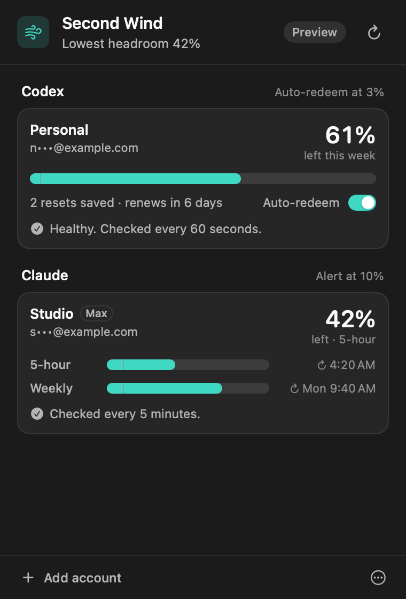
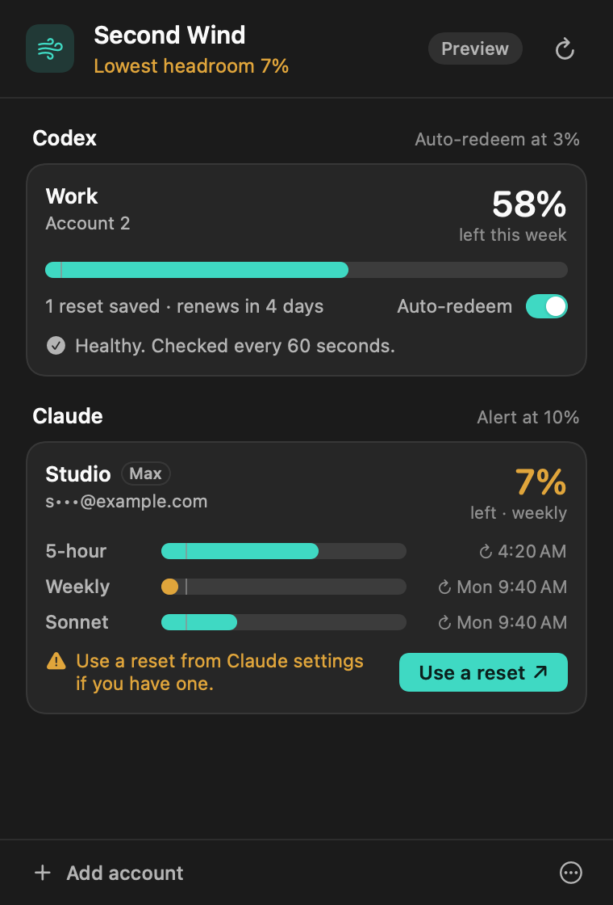

# Second Wind

A native macOS menu-bar app that watches your Codex and Claude usage limits and
helps you use a reset before you hit the wall. For Codex it can redeem a saved
weekly reset for you. For Claude it warns you early and takes you straight to the
page where you redeem one.

**Source preview · macOS 14+ · Swift 6+ · MIT**

[](https://github.com/nicolasdmolina/codex-weekly-reset-guard/actions/workflows/ci.yml)

<p>
  
  
</p>

Independent community software. Not affiliated with or endorsed by OpenAI or
Anthropic. Codex and ChatGPT are OpenAI products; Claude and Claude Code are
Anthropic products. Second Wind does not grant or purchase resets, and reset
availability depends on your account, plan and app versions.

Second Wind was called Codex Weekly Reset Guard before version 0.2.0. Installing
it moves your existing accounts over on first launch.

## What it does

**Codex**

- Monitor one or more separately signed-in Codex accounts.
- Show weekly headroom, when the allowance renews, and how many resets are saved.
- Optionally redeem after two fresh weekly readings at or below **3% remaining**,
  at least five seconds apart, with at least five minutes until the natural reset.
- Keep a durable idempotency key so an uncertain request can be reconciled.

**Claude**

- Monitor one or more Claude Pro or Max accounts, each signed in separately.
- Show the 5-hour session limit, the weekly limit and any per-model weekly limits.
- Notify you once per limit cycle when any of them falls to **10% remaining**.
- Open **Claude Settings › Usage** with one click, where you can reset a limit
  for free if Anthropic has given you one.

Claude resets are redeemed by you, not by the app. Anthropic only offers them on
claude.ai and in Claude Desktop, so Second Wind sends you there instead of acting
on your behalf.

Automatic Codex redemption and launch at login stay **off until you turn them on**.
The Codex trigger uses the canonical weekly `codex` allowance only; short-window
and model-specific exhaustion cannot trigger it. Turning on auto-redeem lets the
app spend a saved reset at the threshold, so up to 3% of a week may go unused.

## Build and install

You need macOS 14 or later and a Swift 6+ toolchain (Xcode or Command Line Tools),
plus the official tools for the services you want to watch:

- Codex: the [Codex CLI or desktop app](https://developers.openai.com/codex/quickstart).
- Claude: [Claude Code](https://docs.anthropic.com/en/docs/claude-code/setup).

No API key and no third-party Swift package is required.

```sh
git clone https://github.com/nicolasdmolina/codex-weekly-reset-guard.git second-wind
cd second-wind
./scripts/test.sh
./scripts/package_app.sh
./scripts/install_app.sh
```

The app installs to `~/Applications/Second Wind.app`. Open it and look for the
wind symbol in the menu bar. The installer keeps a backup when replacing an
existing install and retires a Codex Weekly Reset Guard bundle if it finds one.
Quit any running copy first.

Builds target the host architecture and are **ad-hoc signed, not notarized**.
There is no Developer ID signed download yet; building locally is the supported
path. Do not disable macOS security protections to run an untrusted download.

## First run

1. Choose **Codex** or **Claude**, enter the account's email and an optional name.
2. Sign in through the browser. Each account gets its own private, app-owned
   folder, so this never signs you out of your everyday Codex or Claude Code.
3. Check the readings. For Codex, leave **Auto-redeem** off to only monitor, or
   turn it on for that account.
4. Add more accounts with **Add account**. Launch at login is in the ••• menu.

Keep the app running and the Mac awake and online for monitoring. It cannot
guarantee you never run out.

## How the Claude side works

Second Wind runs the official `claude` executable with `CLAUDE_CONFIG_DIR` set to
the account's private folder:

- `claude auth login --claudeai --email <email>` to sign in.
- `claude auth status --json` to confirm the account and plan.
- `claude -p /usage --output-format json --no-session-persistence` every five
  minutes to read limits. This is Claude Code's local usage command; it does not
  send a prompt to a model and does not count against your limits.

If a future Claude Code answers `/usage` with a model turn instead, Second Wind
stops polling that account until you reconnect it, so background checks can never
spend usage. It never reads Claude credentials, never calls Anthropic directly,
and never runs Claude Code's reset command.

Claude Code is found at the first of `~/.local/bin/claude`,
`~/.claude/local/claude`, `/opt/homebrew/bin/claude` and `/usr/local/bin/claude`.

## Codex compatibility

Schema compatibility was checked against Codex CLI **0.145.0** and **0.153.4**.
These are tested protocol versions, not a guaranteed minimum. The app needs the
official app-server account, rate-limit, reset-inventory and consume methods;
missing or ambiguous data prevents redemption.

Codex is found at the first of `~/.local/bin/codex`,
`/Applications/Codex.app/Contents/Resources/codex`, `/usr/local/bin/codex` and
`/opt/homebrew/bin/codex`. If an old CLI shadows a newer desktop app, update it.

For a live **no-consume** Codex diagnostic, quit Second Wind and run:

```sh
"$HOME/Applications/Second Wind.app/Contents/MacOS/SecondWind" --doctor
```

It reads enrolled accounts and usage but never redeems a reset or rewrites saved
policy or history.

## Development

```sh
./scripts/test.sh
./scripts/test_tooling.sh
./scripts/native_release_check.sh
python3 scripts/test_public_release.py
python3 scripts/check_public_release.py
```

`swift run SecondWind --preview overview` opens the real controls in a window with
synthetic data. Other fixtures: `onboarding`, `connect`, `paused`, `healthy`,
`near`, `redeemed`, `auth-error`, `claude-low` and `claude-signin`. Previews never
start sign-in or contact any service. `SECOND_WIND_LIVE_CLAUDE=1 swift test`
adds a check against your installed Claude Code using a fresh signed-out folder.

`swift scripts/make_icon.swift .` regenerates the app icon.

See [architecture](docs/ARCHITECTURE.md), [design](DESIGN.md),
[contributing](CONTRIBUTING.md), [privacy](docs/PRIVACY.md),
[security reporting](SECURITY.md) and the [release checklist](docs/RELEASING.md).

## License

[MIT](LICENSE), copyright 2026 Nicky Molina. Apple system frameworks and your
separately installed Codex and Claude Code software remain under their own terms.
